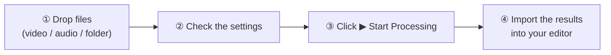
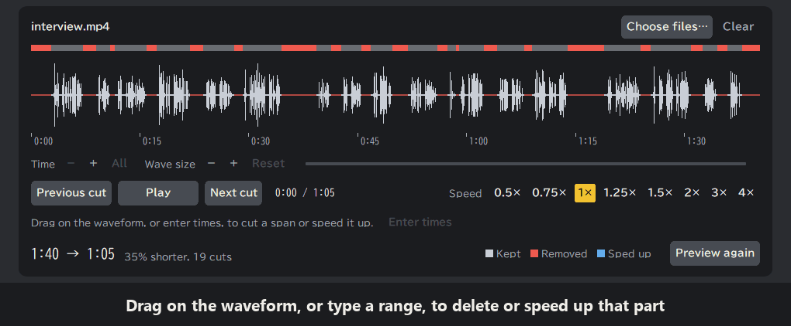
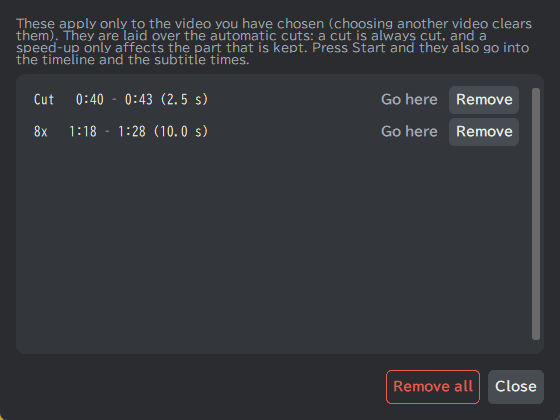
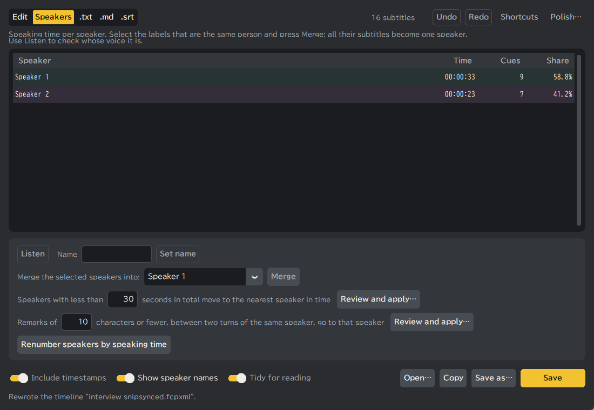
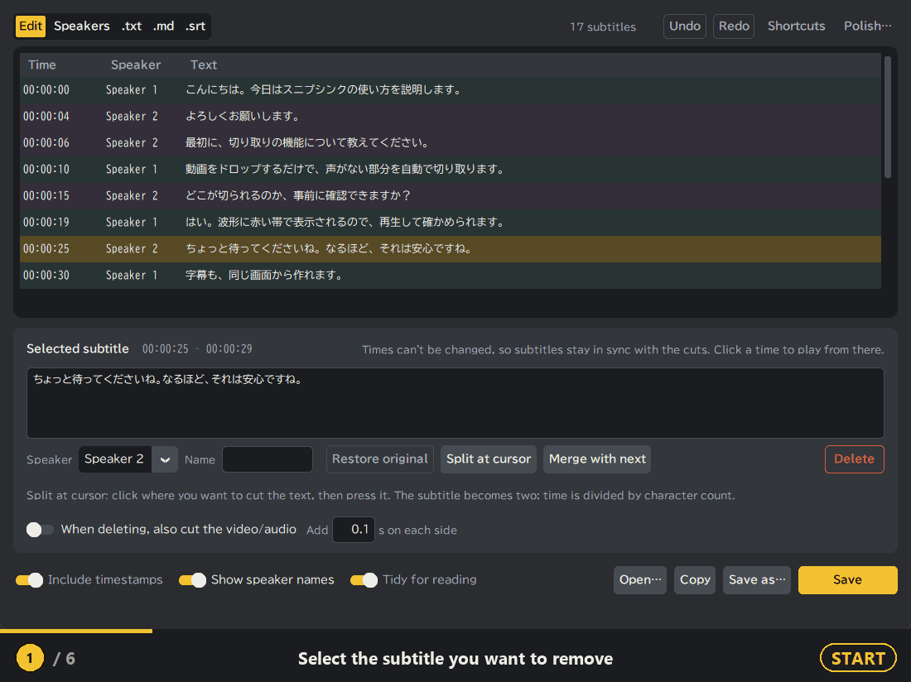
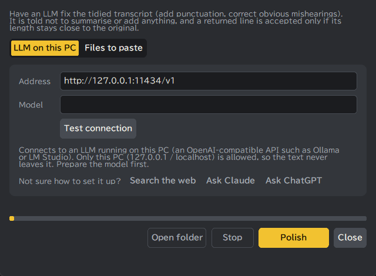
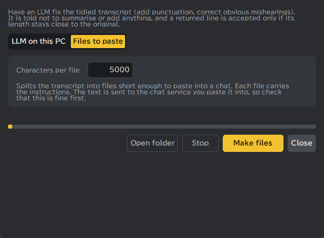

<div align="center">

<h1>✂ SnipSync</h1>
<p><strong>A Windows app that automates silence cutting, AI subtitles and speaker-labelled transcripts, and exports timelines you can import straight into your editor</strong></p>

[](https://www.python.org/)
[](https://github.com/TomSchimansky/CustomTkinter)
[](https://github.com/SYSTRAN/faster-whisper)
[](https://github.com/WyattBlue/auto-editor)
[](LICENSE)
[](https://www.microsoft.com/windows)
[](https://github.com/R3NeR3N/SnipSync/releases/latest)

[English](README.md) | [日本語](README_JA.md) | [简体中文](README_ZH.md) | [한국어](README_KO.md)

</div>

---

**Contents**

- [About SnipSync](#about-snipsync)
- [✨ Features](#-features)
  - [Supported Export Formats](#supported-export-formats)
  - [Supported Input Formats](#supported-input-formats)
- [🚀 Installation](#-installation)
  - [Option A: Run the Pre-built EXE (Recommended)](#option-a-run-the-pre-built-exe-recommended)
  - [Option B: Run from Source](#option-b-run-from-source)
  - [Option C: Build the EXE yourself (PyInstaller)](#option-c-build-the-exe-yourself-pyinstaller)
- [⚙️ How to Use](#%EF%B8%8F-how-to-use)
  - [Quick start](#quick-start)
  - [Settings](#settings)
  - [Recipes](#recipes)
  - [Importing into your editor](#importing-into-your-editor)
  - [Notes](#notes)
- [🖥️ Requirements](#%EF%B8%8F-requirements)
  - [Runtime (EXE users)](#runtime-exe-users)
  - [Development (source users)](#development-source-users)
- [📜 License](#-license)

---

## About SnipSync

**SnipSync** is a standalone desktop application for Windows that automates the most tedious parts of video editing. **It works on audio files too, not just video.** Drop in your video or audio footage, and SnipSync will:

1. **Detect and remove silent segments** using a configurable audio threshold — powered by `auto-editor`.
2. **Export a ready-to-import timeline** in the format of your choice (.fcpxml or .xml) — no rendering required.
3. **Generate a perfectly-synced subtitle file** (.srt) using the built-in AI transcription engine `faster-whisper`.

Because the subtitle pipeline runs transcription on the *already-cut* audio (not the raw source), timecodes in the `.srt` file are always in perfect sync with the exported timeline — a problem that plagues most other tools.

**Hand-tune it after the automatic pass.** Select a span on the waveform by dragging or by typing times, and delete it or speed it up. In the review window, deleting a subtitle can also cut that span of video and audio, and rewrites the subtitles and the timeline. Saved edits can be reopened later.

> 🔒 **Your recordings never leave your PC.** Silence cutting, transcription and speaker separation all run locally. Once the AI model is downloaded, you can edit video and audio **with no internet connection**. The only network use is the one-time download of models and GPU components and a once-a-day update check (which you can turn off); your video and audio are never uploaded. The one exception is when you paste text into a chat yourself with the Polish “files to paste” option, which sends that text to the chat service.

No Python installation required. SnipSync ships as a single `.exe` file.

**It also works for meeting minutes.** Give it a recording of a meeting (Zoom, Teams, or in person) and it transcribes the audio with the silences taken out, split by speaker, and writes `.txt` or `.md`. Speakers can be given names such as "Yamada" and "Sato", so the result is a ready first draft of the minutes. Audio-only files work too. Transcription and speaker separation still make mistakes, so fix them in the subtitle review window before saving.

---

## ✨ Features

| Feature | Details |
|---|---|
| 🔇 **Auto Silent Cut** | Automatically detects and removes silent portions from any video or audio file |
| 🎙 **Voice-Activity Cut** | Choose volume threshold or speech detection (Silero VAD); optionally speed silence up instead of cutting |
| 🎬 **NLE Timeline Export** | Exports cut-ready timelines for DaVinci Resolve, Final Cut Pro, and Premiere Pro |
| 📝 **AI Subtitle Generation** | Generates `.srt` files with `faster-whisper` — no timecode drift |
| 📁 **Drag & Drop** | Simply drag your video or audio files (several at once, or a whole folder) onto the app window |
| 🧩 **Batch & Audio Files** | Drop several files or a folder; audio-only inputs and cut-media export supported |
| 🔒 **Offline & Private** | Recordings are never sent to any online service; once the models are downloaded, no internet connection is needed |
| 〰 **Waveform Preview** | See exactly what will be cut before you process; zoom the time axis and the wave height separately |
| ✋ **Manual Cuts & Speed-ups** | Drag a span on the waveform, or type its start and end, then delete it or speed it up. It is laid over the automatic cuts and shows up at once |
| 🈶 **Readable Subtitles** | Japanese phrase-aware line breaks (BudouX), glossary hints, optional speaker separation |
| ✂ **Delete a Subtitle, Cut the Footage** | In the review window, deleting a subtitle can also cut its video and audio; the subtitles and the timeline are rewritten |
| 📄 **Transcript Export** | Preview and save the whole transcript as `.txt` / `.md` / `.srt` |
| 🧹 **Transcript Polish (LLM)** | Add punctuation and fix obvious mishearings with an LLM on your PC (the text stays on it), or with files to paste into a chat |
| 🔁 **Resume Editing** | Reopen a saved session (`<name>.snipsync.json`): speaker names, change marks, the source video and manual spans come back |
| 📍 **Timeline Markers** | Optional cut-point / speaker-change / subtitle-start markers (confirmed in DaVinci Resolve 21; not yet verified in Premiere Pro or Final Cut Pro) |
| 🤖 **AI Model Choice** | Pick `tiny` / `base` / `small` / `medium` / `large-v3-turbo` / `large-v3` for the speed and accuracy you need. Also available: `kotoba-whisper` (Japanese-specialised, experimental) and `distil-large-v3` (English only) |
| ⚙️ **Fine-grained Controls** | Adjustable volume threshold (%) and silence margin (seconds) |
| 🌐 **Multilingual UI** | Full Japanese / English interface switchable at runtime |
| 📦 **Zero Setup** | Ships as a single `.exe` — no Python, no dependencies to install |

### Supported Export Formats

| Format | Target Application | File Extension |
|---|---|---|
| `resolve` | DaVinci Resolve | `.fcpxml` |
| `final-cut-pro` | Final Cut Pro | `.fcpxml` |
| `premiere` | Adobe Premiere Pro | `.xml` |

### Supported Input Formats

| Video files | Audio files |
|---|---|
| `.mp4` | `.wav` |
| `.mov` | `.mp3` |
| `.avi` | `.m4a` |
| `.mkv` | `.flac` |
| `.wmv` | `.aac` |
| `.flv` | `.ogg` |
| `.webm` | `.opus` |
| `.m4v` | `.wma` |

---

## 🚀 Installation

### Option A: Run the Pre-built EXE (Recommended)

> No Python, FFmpeg, or any other software needed.

1. Download `SnipSync.exe` from the [Releases](https://github.com/R3NeR3N/SnipSync/releases/latest) page.
2. Place it anywhere on your PC (e.g., your Desktop).
3. Double-click `SnipSync.exe` to launch.

**First-run downloads** (internet required, once only):

| What | When | Size |
|---|---|---|
| Whisper model | The first time you generate subtitles with that model | `tiny` 0.08 GB · `base` 0.15 GB · `small` 0.49 GB · `medium` 1.5 GB · `large-v3-turbo` 1.6 GB · `large-v3` 3.1 GB · `distil-large-v3` 1.5 GB · `kotoba-whisper` 1.5 GB |
| Speaker-separation models | The first time you turn on **Separate speakers** | about 35 MB |
| GPU components (cuBLAS, cuDNN) | When you start with **Use the GPU** on and allow the download (NVIDIA GPUs only) | about 1.4 GB (about 2.1 GB once unpacked) |

> **💡 Where things are stored (and how to remove them)**
> - Whisper models: `C:\Users\<YourUsername>\.cache\huggingface\hub`
> - kotoba-whisper, speaker-separation models, presets: `%APPDATA%\SnipSync`
> - GPU components: `%APPDATA%\SnipSync\cuda` (open it with the **Parts folder** button next to **Use the GPU**)
>
> Deleting `SnipSync.exe` does not remove them. To free disk space, delete those folders manually.
>
> The GPU components are SnipSync's own copy. They are not installed into Windows or any other app, so **deleting them is safe**. Other apps are not affected. SnipSync simply asks again the next time you use the GPU (the CPU works without them).

**Updates:** Once a day at startup, SnipSync asks GitHub whether a newer version exists, and asks Hugging Face whether the Whisper models you have downloaded have changed. If so, an **Updates** window opens, and nothing is replaced until you press its button. You can turn the check off, or run it by hand (**Check now**), from the **Updates** button at the top right. The requests are ordinary GitHub and Hugging Face API calls; none of your files or settings are sent. A new SnipSync is taken from the official GitHub release and installed only if its SHA-256 matches. After a model update, the old copy stays on disk.

---

### Option B: Run from Source

#### Prerequisites

- Windows 10 / 11 (64-bit)
- [Python](https://www.python.org/downloads/) 3.10 or later (tick **Add python.exe to PATH** in the installer)
- [Git](https://git-scm.com/downloads) (or download the repository as a ZIP from GitHub and unzip it)
- FFmpeg is **not** required.

#### Steps (PowerShell or Command Prompt)

```bash
git clone https://github.com/R3NeR3N/SnipSync.git
cd SnipSync
python -m venv .venv
.venv\Scripts\python.exe -m pip install -e .
.venv\Scripts\python.exe -m snipsync
```

`python -m venv .venv` creates an isolated environment inside the `SnipSync` folder, so nothing is installed system-wide. To remove it, just delete the `.venv` folder.

The first time you process a file, SnipSync downloads auto-editor 31.7.2 (about 45 MB) from its official GitHub release and verifies its SHA-256 before using it.

---

### Option C: Build the EXE yourself (PyInstaller)

Run these in the same `SnipSync` folder (after the steps above):

```bash
.venv\Scripts\python.exe -m pip install -e ".[build]"
.venv\Scripts\python.exe scripts\fetch_auto_editor.py
.venv\Scripts\python.exe -m PyInstaller build\app.spec
```

`fetch_auto_editor.py` downloads auto-editor (SHA-256 verified) so that it can be bundled into the EXE. The result is written to `dist\SnipSync.exe`.

**Is the EXE (or the source run) the latest?** The version number (`0.3.0`) does not change while you are developing. So a build made on your own PC shows an ID computed from the source contents next to the version in the header, like `v0.3.0 · dev 1a2b3c4`; hover over it to see the commit, whether there were uncommitted changes, and when it was stamped. After you change the source and rebuild, the ID changes; if it does not, you are looking at an old EXE. Running from source computes the ID at every start. The ID is not committed, and the release EXE built by GitHub Actions has none (the header shows only `v0.3.0`).

---

## ⚙️ How to Use

### Quick start



> The screenshots use a short sample recording of two synthesized voices. SnipSync's screen is available in Japanese and English (switch with the **Language** menu at the top right); the screenshots show the English screen.

#### 1. The main window

<p align="center"></p>

| # | Where | What it is |
|:-:|---|---|
| ① | Choose files / Clear | You can also drop video or audio files (several, or a whole folder) onto the waveform. **Choose files…** opens a file picker |
| ② | Waveform | See what will be cut *before* you process. **Red** is removed, **blue** is sped up, grey is kept. Click the waveform to move the playhead there. Drag to select a span for a manual cut or speed-up; the buttons under it zoom |
| ③ | Playback | Previous cut / Play / Next cut, and playback speed (0.5× to 4×). Listen to the result before processing |
| ④ | Length and reduction | Length before → after, percent shorter, number of cuts. After changing a setting, press **Preview again** |
| ⑤ | Setting tabs | **Cut** (method, threshold, padding, silence), **Subtitles** (AI model, speakers, …), **Export** (format, save folder, …) |
| ⑥ | Preset | Save a whole set of settings and recall it later |
| ⑦ | **Start processing** | Runs everything. **Stop** cancels |
| ⑧ | Open output folder / Review subtitles | Available once processing has finished |
| ⑨ | Log | Shows the progress |

The Subtitles and Export tabs look like this.

<p align="center"></p>

<p align="center"></p>

#### 2. Press Start and watch the log

<p align="center"></p>

The **Log** at the bottom shows each step: cutting, speech recognition (with the recognised text), speaker separation, and the files written. When it finishes, **Open output folder** opens the place where the files were written.

Outputs are written next to each input file (or to the folder you choose). With **Make a dated folder for each run** on (the default), they go into a `date_model` folder inside it (for example `2026-10-04_190357_large-v3`). Files appear at two moments.

**① After you press Start processing, while processing runs**

| File | What it is |
|---|---|
| `<name>_snipsynced.fcpxml` / `.xml` | The cut timeline, written as soon as cutting finishes. For a video with several audio tracks and `.fcpxml`, a `<name>_tracks` folder with the extracted audio is written too (keep it next to the `.fcpxml`) |
| `<name>_snipsynced.mp4` / `.mov` / `.mkv` / `.wav` … | The cut video / audio, when the export format is *Video / audio* |
| Working files such as `<name>_temp_audio.wav` | Exist only while subtitles are being made, then are deleted automatically |

**② When you press Save in the subtitle review window**

While **Review before saving** is on (the default), processing pauses at the subtitle review window. No subtitle file exists yet. Pressing Save writes the files below once, **with your edits applied**.

| File | What it is |
|---|---|
| `<name>.srt` | Subtitles, with speaker names (optional) and line wrapping applied |
| `<name>.txt` | The whole transcript, only if you ticked *.txt transcript*. Times are included or not according to the *Include timestamps* switch in the window |
| `<name>.md` | The whole transcript with headings, only if you ticked *.md transcript* |

- The destination is shown at the bottom of the window ("Saves to: …"). *Save as…* writes only the format you are viewing, to the place you choose.
- If you close the window without saving, no subtitle files are written (the timeline or media already exists from ①).
- Closing the window lets processing continue. After the last file, the main window log shows "Processing finished".
- With **Review before saving** off, the subtitle files are written at ①. You can still reopen them later with **Review subtitles**, edit, and save again (the same files are overwritten).
- Speaker-change markers (when the markers option is on) are added right after you save the subtitles, using the speakers and speaker names **as you edited them**. Cut-point markers are already in the timeline at ①. If you close without saving, no speaker-change markers are added. With **Review before saving** off, they come from the subtitles at ①. For Resolve, this rewrites `_markers.edl` instead (see the Markers note below).
- Speaker names can be switched on or off with **Show speaker names** at the bottom of the window. Off removes `Speaker 1: ` from the saved, copied and previewed `.srt` / `.txt` / `.md` and keeps only the text. It starts on. It cannot be pressed when no cue has a speaker. It has no effect on speaker-change markers.

#### 3. (Optional) Check what will be cut — the waveform

<p align="center"></p>

| # | What it shows |
|:-:|---|
| ① | Length before → after, percent shorter, number of cuts |
| ② | Colour key: kept / removed / sped up |
| ③ | **Preview again** — press it after changing the cut settings to recalculate |
| ④ | Playback, jumping to the previous or next cut, and playback speed |
| ⑤ | The bar above the waveform: **red** = removed, **blue** = sped up, grey = kept |
| ⑥ | Zoom: the **Time** and **Wave size** buttons, **All**, and the scroll bar |
| ⑦ | Manual cuts: drag a span (or press **Enter times**), then **Cut it** / **Speed up N x** |

**Zooming the waveform:** the **Time** buttons (or the mouse wheel over the waveform) zoom in and out along the time axis, down to half a second; the point under the cursor stays put. While zoomed in, Shift + wheel or the scroll bar moves left and right, and **All** shows everything. **Wave size** (or Ctrl + wheel) makes the waveform taller so quiet sounds are visible. Zooming does not change the cuts.

**Entering a span by numbers:** press **Enter times** (it starts a 5-second span at the play position), or drag a span first, then type **From** and **To** as `90`, `1:30`, `1:30.25` or `0:01:30.250`. Press Enter to confirm; a value that cannot be read, or an end that is not later than the start, goes back to the previous span. The span is clamped to the video length.

**Manual cuts and speed-ups:** drag on the waveform to select a span, then press **Cut it** or **Speed up N x** (N is the Speed value of the Cut tab). The span is laid over the automatic cuts and shows up on the waveform at once, so you can play it to check. **Manual edits: N…** lists them and removes them one by one. A cut is always cut; a speed-up affects only the part that is kept. They apply to the video you have chosen (choosing another clears them), and they go into the timeline, the subtitle times and the editing session when you press Start. A speed-up also speeds up the audio that subtitles are made from, so a very high rate can make the recognised text unreliable.

<p align="center"></p>

The animation loops through these 6 frames. The number at the bottom left of each frame is the step (for example 1 / 6); the first frame is tagged **START** and the last **END**.

1. Drag on the waveform, or type a range, to delete or speed up that part
2. Once a range is selected, its start and end show as numbers
3. Edit the numbers to set the range precisely
4. Deleted ranges turn red
5. Sped-up ranges turn blue
6. Zoom the time axis and the wave height separately

**Manual edits: N…** lists the spans you set and removes them one by one.

<p align="center"></p>

#### 4. (Optional) Read and fix the subtitles — the review window

<p align="center"></p>

| # | What you can do |
|:-:|---|
| ① | The subtitle list. Select a row to edit it below. Select several rows with Shift or Ctrl to change them together. Rows you changed are marked |
| ② | Undo / Redo. Every edit can be undone |
| ③ | Switch the view: edit, or preview exactly what `.txt` / `.md` / `.srt` will contain |
| ④ | Edit the text of the selected subtitle |
| ⑤ | Change the speaker (for all selected rows at once) and type a speaker name such as "Yamada" |
| ⑥ | Split at the cursor, merge with the next subtitle, restore the original, delete |
| ⑦ | **Include timestamps** (`.txt` / `.md`) and **Show speaker names**. They change what is saved and copied |
| ⑧ | **Save**. **Save as…**, **Copy** and **Open…** are next to it |

- **Speakers tab:** lists each speaker with their speaking time, cue count and share. Speaker separation can split one person into dozens of labels. Select the labels that are the same person and **Merge** them into one; **Listen** plays the speaker's longest cue in the main window so you can tell whose voice it is; **Set name** names a speaker. Two automatic helpers move tiny labels (less than 30 seconds in total, by default) and short remarks between two turns of the same speaker to the nearest speaker in time, after showing you how many speakers remain. **Renumber** orders speakers by speaking time. Every step can be undone.

<p align="center"></p>

- **Click a time** (in the list, or above the text box) to play the main window's preview from that subtitle. It works when the video is chosen in the main window and the cut map is shown.
- **Delete a subtitle and cut its video and audio at the same time:** turn on **When deleting, also cut the video/audio** under the subtitle, then delete a subtitle. Its span, plus a **margin** on each side (default 0.1 s), is marked for cutting, and the mark also shows on the main window's cut map when the same video is open there. Undo removes the mark. **Save** asks for confirmation, re-times the saved subtitles, and overwrites the timeline in place. **Save as…** writes the subtitles and the timeline (`<name>_snipsynced.<extension>`) under the new name and leaves the original files alone. If rewriting the timeline fails, that is remembered and the next save retries it. It is unavailable while the subtitles are still waiting for the pre-save review, and when the export is the video or audio file itself.

<p align="center"></p>

The animation loops through these 6 frames. The number at the bottom left of each frame is the step (for example 1 / 6); the first frame is tagged **START** and the last **END**.

1. Select the subtitle you want to remove
2. Turn on “When deleting, also cut the video/audio”
3. Deleting marks that span to be cut
4. The cut map in the main window shows it in red
5. Save asks for confirmation, then rewrites the subtitles and the timeline
6. The timeline has been rewritten

- **Where the .srt goes:** every time you save, the log in the main window shows when the first subtitle appears on the timeline (for example `00:00:23:10`). DaVinci Resolve trims the empty time before the first subtitle when it imports an SRT, so put the left edge of the subtitle track (the first subtitle) at that time; if it already sits there after importing, there is nothing to move. When the opening is sped up or cut, the first subtitle is far from 0 s. If timeline markers are on, a green marker named **Subtitles start** is also placed at that time.
- **Pick up where you left off:** saving also writes `<name>.snipsync.json` next to the output. **Open saved…** (main window) or **Open…** (editor) reads it back after you restart the app: speaker names, the marks for changed rows, the source video and the cut settings come back. An `.srt` alone can be opened too; its `Speaker N:` prefixes are read as speakers, but names, change marks and the video are not kept.
- **Polish… (LLM):** have an LLM add punctuation and fix obvious mishearings in the tidied transcript. Two ways. **LLM on this PC** talks to an OpenAI-compatible server running on your PC (Ollama, LM Studio, llama.cpp server). Only `127.0.0.1` / `localhost` is accepted, so the text never leaves the PC; prepare the model yourself and enter its name. **Files to paste** writes a `<name>_polish` folder with `00_howto.md` and `01.txt`, `02.txt`… (instructions plus text, split to a length you choose) for pasting into the chat you normally use; that sends the text to that service, so check first. The LLM is told not to summarise or add content, and a returned line is accepted only if its length stays close to the original; otherwise the original line is kept. The result is written as `<name>_polished.txt` / `.md`; the `.srt` and your editing are not touched.

<p align="center"></p>

<p align="center"></p>


<p align="center"></p>

The animation loops through these 6 frames. The number at the bottom left of each frame is the step (for example 1 / 6); the first frame is tagged **START** and the last **END**.

1. The subtitle list. Select a row to edit it below
2. Select several rows with Shift or Ctrl
3. Change the speaker of all selected rows at once
4. Give a speaker a name
5. The .srt preview, with the speaker name
6. Turn off “Show speaker names” to write without names

#### 5. Import the results into your editor

See [Importing into your editor](#importing-into-your-editor) below.

### Settings

| Setting | What it does |
|---|---|
| **Padding around speech** | Extra time kept around speech at each cut (default `0.20 s`) |
| **Volume threshold** | Level below which sound counts as silence (default `4.0 %`). Not used by *Voice detection* |
| **Method** | *Volume threshold*, or *Voice detection (VAD)* — cuts everything that is not a human voice, so it usually copes better with background noise |
| **Silence** | *Cut out* removes silence; *Speed up* keeps it but plays it at the speed you set (default ×8) |
| **Output** | DaVinci Resolve, Premiere Pro, Final Cut Pro, or *Cut media* (a rendered video/audio file) |
| **Make a dated folder for each run** | On by default. Creates a `date_model` folder (for example `2026-10-04_190357_large-v3`) inside the save folder and writes everything there. Each run gets its own folder, so earlier results are never overwritten. When you process several files at once, they all go into the same folder. If subtitles are off, the name is the date only. A `.fcpxml` stores the location of its audio (`_tracks`) as an absolute path, so do not move the folder after importing. If you did, choose **Yes** in Resolve's dialog and point it at the `_tracks` folder |
| **Make subtitles** | Generate `.srt` with Whisper |
| **Review before saving** | On by default. After the subtitles are made, processing pauses in the review window; fix them, then save |
| **AI model** | `tiny`/`base`/`small` are fast; **`large-v3-turbo` is the recommended accurate model**; `kotoba-whisper` is Japanese-specialised but experimental (its word timing is coarse); `distil-large-v3` is English only |
| **Use the GPU** | Optional. Needs an NVIDIA GPU. The first time, it asks before downloading the components (about 1.4 GB) |
| **New subtitle at every cut** | Starts a new subtitle at every cut, so subtitles line up with your clips |
| **Characters per line** | Wraps Japanese at natural phrase boundaries (BudouX) and keeps each subtitle to 2 lines. `0` turns it off (default `20`) |
| **Label speakers** | Labels who is speaking (`Speaker 1: …`) and starts a new subtitle when the speaker changes. Set **Speakers** (2 to 20) if you know how many people there are: that is the most accurate. On **Auto**, small speaker labels with a similar voice are merged into larger ones, and anything left can be fixed in the review window's Speakers tab |
| **Add punctuation** | Adds `、` `。` `？` to Japanese transcripts, using a sample sentence for Whisper and the pauses between words. It goes into `.txt` / `.md` and the editor, never into the `.srt` (subtitles carry no commas or full stops) |
| **Tidy the transcript** | In `.txt` / `.md`, a short remark from another speaker (8 characters or fewer) inside someone's turn is put in brackets in the middle of the sentence, so the sentence is not broken up. Long turns are split into paragraphs at sentence ends. The `.srt` is unchanged. Turn it off in the editor with **Tidy for reading** |
| **Also save** (**.txt transcript**, **.md transcript**) | Saves the whole transcript (with speakers and timestamps) next to the subtitles |
| **Markers (experimental)** | Adds markers for every cut and every speaker change to the timeline. For Resolve only, they are written to a separate `<name>_markers.edl` file *(experimental — see notes)* |
| **Glossary** | Comma-separated terms (names, product names) that Whisper should prefer |
| **Preset** | Save and load a whole set of settings. Your last settings are restored on launch |

### Recipes

- **Talking-head video → DaVinci Resolve with subtitles**: Export Format *DaVinci Resolve*, Subtitles on, model `large-v3-turbo`. Import the `.fcpxml`, then the `.srt`.
- **Interview or podcast with several people**: tick **Separate speakers** (set **Speakers** if you know the count) and **Also write .md**. You get speaker-labelled subtitles and a readable transcript.
- **Noisy room or background music**: set **Cut Method** to *Voice detection (VAD)*.
- **Keep the pauses but make them fast**: set **Silence** to *Speed up*.
- **A pile of recordings**: drop the whole folder. The AI model is loaded once and reused.
- **Just need a clean audio file**: drop a `.wav` / `.m4a` / `.mp3`, choose *Cut media*. You get a `.wav` (see notes).

### Importing into your editor

Menu names can differ slightly between versions.

| Editor | Timeline | Subtitles |
|---|---|---|
| DaVinci Resolve | File → Import → Timeline… → choose the `.fcpxml` | File → Import → Subtitle…, or drag the `.srt` onto the timeline |
| Premiere Pro | File → Import → choose the `.xml` | Import the `.srt` and drag it onto the sequence |
| Final Cut Pro | File → Import → XML… → choose the `.fcpxml` | File → Import → Captions… |

### Notes

- **Cut media export at 4K**: the bundled auto-editor (no license key) scales rendered output down to 3200×1800 or less. SnipSync warns you before it starts. **Timeline exports are not affected** — use them for full-resolution work.
- **Audio-only cut media** is written as `.wav` / `.flac` / `.ogg` / `.opus`. `.mp3`, `.m4a`, `.aac` and `.wma` are written as `.wav` because the bundled auto-editor has no encoder for them.
- **Markers** are experimental: they are confirmed to import into DaVinci Resolve 21, but not yet verified in Premiere Pro or Final Cut Pro. **DaVinci Resolve does not read markers from `.fcpxml`**, so for Resolve they are written to a separate `<name>_markers.edl` (blue = cut point, yellow = speaker change, green = start of the subtitles). In the Media Pool, right-click the **icon of the timeline** you want to mark, choose **Timelines > Import > Timeline Markers from EDL**, then pick that file. Do not use the menu that opens when you right-click an empty area (Timeline > Import > AAF / EDL / XML…): it loads the EDL as a separate timeline of one-frame clips. The EDL's times follow the timeline's start timecode. For Premiere Pro and Final Cut Pro, the markers go inside the timeline file.
- **Cuts differ from SnipSync 0.1.0**: the newer auto-editor also removes cuts and clips that are too short (`--smooth`), so you will see fewer, longer cuts.
- Subtitles start at the first spoken word, so each subtitle begins a little after the start of its clip. This is expected (the margin is kept silent).

---

## 🖥️ Requirements

### Runtime (EXE users)
- **OS:** Windows 10 / 11 (64-bit)
- **RAM:** 4 GB minimum; 8 GB+ recommended for `medium` and larger models
- **Disk:** about 0.1–3 GB for the Whisper model you choose (first run only)
- **Internet:** For first-run downloads (Whisper models, speaker-separation models) and the once-a-day update check (it can be turned off)
- **GPU:** (Optional) NVIDIA GPU. The components it needs (cuBLAS, cuDNN) are not bundled in the EXE; they are downloaded on first use, with your permission.

### Development (source users)

| Package | Purpose |
|---|---|
| auto-editor 31.x *(official binary, fetched and verified by `src/snipsync/core/aebin.py`)* | Silence/voice cut engine & NLE export |
| `faster-whisper` | AI speech-to-text (CTranslate2) and Silero VAD |
| `sherpa-onnx` | Speaker separation |
| `budoux` | Japanese phrase-aware line breaks |
| `defusedxml` | Safe XML parsing |
| `av` · `numpy` | Audio decoding and processing |
| `customtkinter` · `tkinterdnd2` | GUI and drag-and-drop |
| `pyinstaller` | *(Build only)* Packages the app into a single `.exe` |

---

## 📜 License

This project is licensed under the **MIT License**.

> **Disclaimer:** SnipSync is provided "as-is" without any warranty. The author is not responsible for any data loss, file corruption, or other issues arising from the use of this software. Always keep backups of your original source footage.

> SnipSync uses [auto-editor](https://github.com/WyattBlue/auto-editor) (Unlicense; the official binary limits *rendered* output to 3200×1800 without a license key, timeline exports are unaffected), [faster-whisper](https://github.com/SYSTRAN/faster-whisper) (MIT), [BudouX](https://github.com/google/budoux) (Apache-2.0) and [sherpa-onnx](https://github.com/k2-fsa/sherpa-onnx) (Apache-2.0). Models: Whisper (MIT), kotoba-whisper (MIT), pyannote segmentation-3.0 ONNX (MIT), 3D-Speaker CAM++ (Apache-2.0). Please refer to each project for their respective licenses.

---

<div align="center">

Made with ❤️ for video creators who hate silence.

</div>
